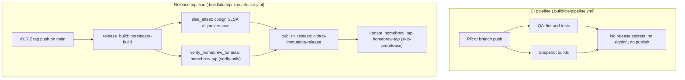

+++
title = "Supply Chain Security for CLI Releases"
date = 2026-11-23T13:25:00+11:00
tags = ["security", "supply-chain", "golang", "ci-cd", "sigstore"]
+++

As a serial builder of tools, mostly CLI based, I have been putting off over-engineering supply chain security in side projects. Those projects have recently overlapped with my day job, so it is time to sort this out properly.

So what do we need in our releases?

- All artifacts should include checksums, giving every user a zero-dependency integrity check.
- Each binary should have a [Software Bill of Materials (SBOM)](https://openssf.org/technical-initiatives/sbom-tools/), so anyone can inspect what was compiled into the archive without rebuilding from source.
- Each binary should come with keyless [SLSA v1 provenance](https://slsa.dev/spec/v1.0/provenance) via [Sigstore](https://www.sigstore.dev/), proving which pipeline and commit built it without long-lived signing keys to store or rotate.
- [GitHub](https://github.com/) releases, or any other forge, should be [immutable](https://docs.github.com/en/code-security/concepts/supply-chain-security/immutable-releases), so a published tag and its assets cannot be silently swapped after the fact.

The goal is to give users practical ways to validate the releases I publish while sharing a pattern others can adopt.

I started this as a step-by-step YAML and shell tutorial, then realised that is the wrong format now. Copy-pasted pipeline instructions don't age well as systems and best practices change over time. What actually transfers is *why* the guardrails exist, what breaks when you cut corners, and a reference implementation you (or a coding agent) can adapt.

I packaged the reusable [Buildkite](https://buildkite.com/) pieces as subdirectory plugins in [wolfeidau/buildkite-release-plugins](https://github.com/wolfeidau/buildkite-release-plugins). At the end of the post there is an example prompt you can give to a coding agent to apply the same pattern to your own project.

## Why CI and releases cannot share a pipeline

Most projects keep tests and releases in one pipeline and gate publishing behind a tag check. That works until you introduce keyless OIDC signing and scoped release credentials.

Instead, split CI and releases into two separate pipelines:

- A CI pipeline (`.buildkite/pipeline.yml`) runs on branches and pull requests. It lints, runs the test suite, and runs snapshot builds to verify packaging. It holds no release token and never signs provenance.
- A release pipeline (`.buildkite/pipeline.release.yml`) runs only on `v*` tags, never on branches or pull requests. It builds the release archives, signs SLSA provenance, validates any package manifests (such as a Homebrew formula), creates the immutable GitHub release, and updates downstream package repositories on stable tags.



Splitting the pipelines and staging releases enforces five guardrails that a single tag-gated pipeline does not.

### OIDC identity scoping

Buildkite's OIDC identity for [cosign](https://github.com/sigstore/cosign) (`https://buildkite.com/<org>/<pipeline>`) names the pipeline, not the git ref. If PR builds and releases shared a pipeline, any build on it would share that signing identity. Moving releases into a tag-only pipeline ensures the identity attests release provenance and nothing else.

### Secret scoping

Storing the GitHub release token as a cluster secret scoped only to the release pipeline keeps credentials out of PRs. Because Buildkite reports tag builds with the tag name as the branch, a `main`-only branch rule on a secret does not work for tags, so the release job also verifies that the tag's commit is an ancestor of `origin/main` before shipping.

### Cache isolation

Restoring build and toolchain caches (such as Go and [mise](https://mise.jdx.dev/)) on every build while saving them only from `main` stops PR and feature branches from poisoning caches that `main` or release builds inherit.

### Atomic immutable publishing

Immutable GitHub Releases lock the moment they publish, so every archive, checksum, SBOM, provenance bundle, and downstream package manifest (such as a Homebrew formula) must be verified before one atomic `gh release create` call. Keeping package-manager updates in a follow-up step lets `-rc.N` prereleases validate without pushing to live users and lets transient tap errors retry cleanly.

### Pinned toolchains and plugins

Signing release artifacts means little if the tools producing them float on `latest`. Pin build, lint, SBOM, and signing tools by explicit version and checksum (for example with `mise` lockfiles), and pin external CI plugins by full 40-character commit SHA.

## Agent prompt

If you want to apply this pattern to your own CLI, hand the prompt below to Claude Code, Codex, Cursor, Antigravity, or whichever coding agent you use (or save it as a reusable agent skill if you maintain several CLIs). It uses [wolfeidau/buildkite-release-plugins](https://github.com/wolfeidau/buildkite-release-plugins) as the reference implementation:

```text
Implement release supply-chain security for this repository using https://github.com/wolfeidau/buildkite-release-plugins as the reference architecture.

First, inspect this repository (language, build tool, target OS/arch matrix, CI provider, package managers, existing release config) and read the plugins and README in wolfeidau/buildkite-release-plugins (goreleaser-build, slsa-attest, github-immutable-release, homebrew-tap, and test.sh).

Before editing files, propose a short plan confirming:
1. How CI and releases will be split into separate pipelines/workflows so the release OIDC signing identity and release credentials are never exposed to PR or branch builds.
2. Whether this repo can consume wolfeidau/buildkite-release-plugins directly (pinned by full 40-character commit SHA on Buildkite Agent v3.108.0+) or should adapt the same staged pattern for its CI provider.
3. Which OIDC issuer and signing identity users will verify against, and whether to use Cosign bundles (.sigstore.json) or GitHub's native attestation flow (note: gh attestation verify only accepts GitHub Actions OIDC certificates; non-Actions CI like Buildkite must ship .sigstore.json bundles verified with cosign).
4. Any manual repo/CI setup required (enabling GitHub immutable releases, creating the tag-only release pipeline, scoping the release secret).

Preserve these invariants in the implementation:
- Pin all build, lint, SBOM, and signing tools to explicit versions and checksums (no latest tags); pin external CI plugins/actions by full commit SHA; lint release scripts with shellcheck.
- Isolate caches so branch/PR builds restore read-only and never write back into caches used by main or releases.
- Build with publishing disabled (--skip=publish, producing archives, checksums, and SPDX JSON SBOMs). Cross-compile on a single runner when possible (such as pure Go with CGO_ENABLED=0); split into parallel native build jobs with split per-artifact .sha256 files only when CGO or native toolchains require it.
- Validate downstream package manifests (such as a macOS Homebrew formula) BEFORE creating the immutable GitHub release so a bad manifest blocks publish.
- Enforce semver tag validation, main ancestry, existing-release refusal, full SHA-256 re-verification, keyless SLSA v1 provenance signing per archive via OIDC (Fulcio + Rekor), and one atomic gh release create call so the release is complete before becoming immutable. Do not add config flags that disable these safety checks.
- Keep prerelease tags (-rc.N) safe to test: validate package manifests on prereleases, but skip pushing to stable taps or package repositories.
- Add or update install.sh to verify progressively (always SHA-256, gh release verify-asset when gh is present and the release is immutable, cosign verify-blob-attestation pinned to the exact OIDC issuer and release identity when cosign is present), failing hard on any failed check, and document manual verification commands in README.md.
```

## Summary

Securing CLI releases does not require managing PGP keys or maintaining complex bespoke infrastructure, but it does require drawing clean boundaries: separate CI from releases, pin the toolchain and plugins by digest or commit SHA, validate every artifact and package manifest before locking an immutable release, and give users layered checks that work with the tools they already have. Feel free to consume [wolfeidau/buildkite-release-plugins](https://github.com/wolfeidau/buildkite-release-plugins) directly or feed the prompt above to your agent to wire up the same pattern in your own projects.
